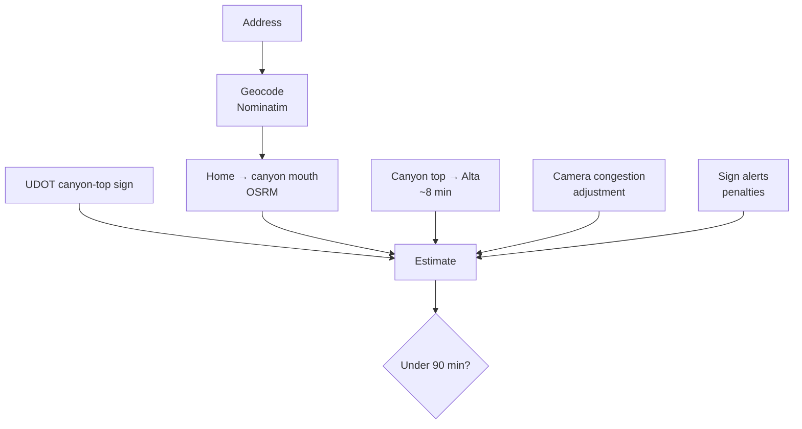

# Alta Drive API (lccTrafficBE)

**The backend for [Little Cottonwood / Alta Drive Time](https://lcc-traffic-fe.vercel.app):** a Node/Express service that turns live UDOT canyon signs, traffic-camera images, routing and weather data into a door-to-Alta drive estimate and a 3-hour canyon outlook.

🔗 **Live app: [lcc-traffic-fe.vercel.app](https://lcc-traffic-fe.vercel.app)**  ·  Front end: [T-dex/lccTrafficFE](https://github.com/T-dex/lccTrafficFE)

---

## How an estimate is built



**Estimate = home → canyon mouth + UDOT canyon-top sign + top → Alta + camera adjustment + alert penalties**

- **Routing:** OSRM gives free-flow times for home → mouth, mouth → Alta and home → Alta.
- **UDOT sign:** the Cottonwood Canyons road-information page is parsed for the Little Cottonwood travel-time sign. If no time is posted, the estimate falls back to free-flow routing and confidence drops to *low*.
- **Sign alerts:** keywords on the signs add time: closure (+45 min), avalanche control (+35), stop/hold (+30), delay (+20), slow traffic (+12), chains or traction law (+8).
- **Verdict:** compares the total against a threshold (90 minutes by default, adjustable 30–240) and returns *likely OK*, *borderline* or *likely long*, along with the segment breakdown and the reasons behind each adjustment.

## Scoring traffic cameras without machine learning

Each UDOT camera image is fetched and scored for congestion using [sharp](https://sharp.pixelplumbing.com/):

1. Crop to the region where the road usually is (the middle-lower part of the frame).
2. Downscale to 160×90 and convert to grayscale.
3. Compute **edge density** (gradient magnitude) and **contrast** (pixel standard deviation). More cars means more edges and more variation.
4. Combine into a 0–1 congestion score, with special handling for washed-out frames (snow glare or night) so they don't read as empty roads.

Scores are averaged across cameras using per-camera weights, with cameras lower in the canyon (where the line forms) weighted more heavily. The weighted average converts to extra minutes. Camera IDs, mileposts and weights live in [`cameras.json`](cameras.json).

## 3-hour canyon outlook

`POST /api/forecast` predicts *Normal*, *Slower* or *Stopped* for up to 4 hours ahead by blending:

- **Current traffic** (UDOT sign vs. clear-road time, camera congestion, closure alerts)
- **Time-of-day ski pressure** in Mountain Time (weekend mornings, afternoon departure rush, Friday evenings, weekday commutes)
- **Weather risk** from the National Weather Service hourly forecast for Alta (snow, wind, precipitation chance, cold with wintry precipitation)

Each prediction includes a confidence level and the top contributing factors, so the UI can explain *why*.

## Caching

Several upstream services are slow or rate-limited, so the API caches aggressively, with TTLs matched to how fast each source changes:

| Data | TTL | Notes |
| --- | --- | --- |
| UDOT canyon signs | 60 s | |
| Camera scan | 120 s | Shared across all users; concurrent requests reuse a single in-flight scan. Configurable via `CAMERA_CACHE_MS` |
| OSRM routes | 1 h | Keyed per route |
| NWS hourly forecast | 10 min | |
| Geocoding | 24 h | |

A small `memo` helper ([`src/lib/memo.js`](src/lib/memo.js)) shares in-flight promises so simultaneous requests don't duplicate upstream calls, and never caches failures. Geocoding calls are also serialized and spaced at least 1.1 s apart to respect Nominatim's usage policy, with one retry on `429` that honors `Retry-After`.

## API

| Method | Path | Description |
| --- | --- | --- |
| `POST` | `/api/estimate` | Full estimate. Body: `address` (required), optional `home_lat`/`home_lon`, `threshold_minutes`, `include_cameras`, `include_forecast` |
| `POST` | `/api/forecast` | Canyon outlook. Body: `hours_ahead` (0–4), optional `udot_top_min`, `sign_alerts`, `avg_camera_congestion` |
| `GET` | `/api/quick?address=…` | Lightweight estimate without camera scans |
| `GET` | `/api/health` | Health check |

All requests time out after 120 s. Errors return JSON with a `detail` message.

## Running locally

Requires Node.js 20+.

```bash
npm install
npm run dev        # or ./run.sh — listens on http://127.0.0.1:8765
```

No API keys are needed. All data sources are public. See [DEPLOYMENT.md](DEPLOYMENT.md) for environment variables and hosting (a `render.yaml` is included).

## Tech stack

Node.js 20 · Express · sharp · native `fetch` and `AbortController` · Data from UDOT, OSRM, Nominatim (OpenStreetMap) and the National Weather Service

## What's next

- Add eviction to the in-memory cache (OSRM keys grow per address)
- Unit tests for sign parsing, camera scoring and the estimate math
- Store estimates over time to learn real canyon patterns instead of hand-tuned weights
- Big Cottonwood Canyon support

## Disclaimer

Unofficial personal project, not affiliated with UDOT. Estimates are approximate. Always check [UDOT Cottonwood Canyons](https://cottonwoodcanyons.udot.utah.gov/road-information/) and drive to conditions.
